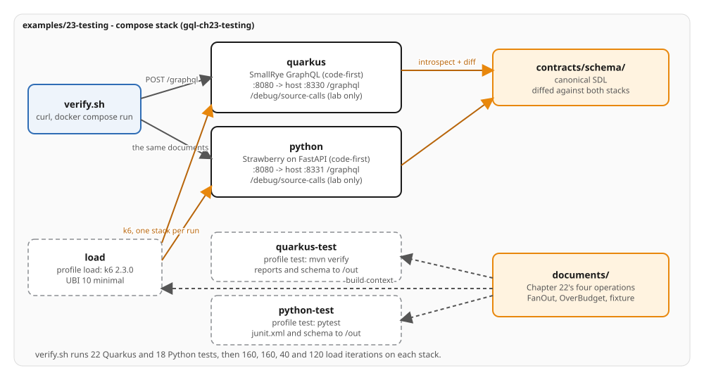

# Ch23 - Testing GraphQL APIs

Six test layers for the tracking view of Chapter 14: the schema each stack builds, resolvers with a
stubbed source, operations over the application's own HTTP layer, the exported and live SDL against the
contract, client documents against the contract, and a k6 load run. The first three run in a `test` stage
of each Containerfile through `docker compose run`; the other three run from `verify.sh`. The servers are Chapter 14's,
unchanged apart from names, ports and a source latency of 50 ms, so this chapter adds tests and no server
code.

## The served slice

`contracts/schema/shipping/*.graphql` is the canonical SDL. Both servers serve everything in it except
`Subscription`, which Chapter 21 builds. Batching, pagination, the error contract and the cost budget of
1,000 are Chapters 13 and 14's. The SDL does not change. `TRACKING_SOURCE_LATENCY_MS=50` shortens a source
call so the load runs finish in seconds; the call counts are the same at 50 ms and at 250 ms.

## The layers

| Layer | Quarkus (22 tests) | Python (18 tests) | Runs in |
|---|---|---|---|
| Schema | `SchemaExportTest` | `test_schema.py` | test image |
| Resolver unit | `DeliveryDerivationTest`, `TrackingCostCalculatorTest`, `BookingFailureTest` | `test_derivation.py`, `test_resolvers.py`, `test_cost.py` | test image |
| Operation | `TrackCargoTest`, `TypedClientTest`, `BatchingTest`, `CostLimitTest`, `FanOutPriceTest`, `IdempotencyTest` | `test_operations.py`, `test_batching.py`, `test_cost_limit.py`, `test_idempotency.py` | test image |
| Contract | the schema each suite exported, and both live URLs | the same | `verify.sh`, `graphql-inspector` |
| Client document | `documents/` against `contracts/schema/` | the same | `verify.sh`, `graphql-inspector` |
| Load | `load/tracking.js` on k6 2.3.0 | the same | `verify.sh`, k6 image |

`documents/` holds the client documents every layer reads: Chapter 22's four operations, one per file
(`track-cargo`, `track-cargo-brief`, `register-handling`, `list-cargos`), `fan-out.graphql` (Chapter 14's
four-cargo page, named `FanOut`), `load/over-budget.graphql` (`OverBudget`, priced 7,651) and
`fixtures/cargo-weight.graphql`, which selects `Cargo.weight` and is refused by validation. The test
and load images receive the directory through `build.additional_contexts`. `verify.sh` checks that the
four operations are the same text as the same-named operations in
`examples/22-client-integration/clients/js/src/operations.graphql`, read-only.

## Run it

```bash
bash examples/23-testing/verify.sh
```

`verify.sh` checks the documents, brings both servers up with `docker compose`, runs both suites in their
test images, diffs the exported and the live schemas against `contracts/schema/`, runs four k6 runs
against each stack and tears the stack down. It prints `PASS` only if every check holds on **both**
stacks. It needs Docker Engine with the `docker compose` plugin and Node/npm (for the pinned
`graphql-inspector` in `contracts/`). Tests and builds run only inside the pinned UBI images.

## Running the tests

The two suites are compose services behind the `test` profile. Each writes its reports and the schema it
exported to `/out`, a directory you mount.

```bash
cd examples/23-testing
mkdir -m 0777 /tmp/ch23-quarkus /tmp/ch23-python
docker compose run --rm -T --build -v /tmp/ch23-quarkus:/out:z quarkus-test
docker compose run --rm -T --build -v /tmp/ch23-python:/out:z python-test
ls /tmp/ch23-quarkus /tmp/ch23-quarkus/surefire-reports /tmp/ch23-python
```

Maven Surefire writes one `TEST-*.xml` per class under `surefire-reports/`; pytest writes `junit.xml`.
Each suite writes the `schema.graphql` it exported, so each runs with its own directory. The test stages
come before the runtime stage in each Containerfile, which stays the default target and does not depend on
them, so `docker compose build quarkus python` builds the production images and runs no test.

The load runner is the `load` profile:

```bash
docker compose up -d --build
docker compose run --rm -T --build -e TARGET=http://python:8080/graphql -e RUN=mix -e STACK=python \
  load run --quiet /scripts/tracking.js
docker compose down -v
```

`RUN` is `fanout`, `cost`, `retry` or `mix` (run `retry` before `mix`: `mix` reads the event `retry`
writes). The summary is one JSON line on stdout.

The suites run in the test images, which copy `documents/` to `src/test/resources/documents/` and `tests/documents/`; `TRACKING_TEST_EXPORT_DIR` and `-Dtracking.test.export-dir` choose where the exported schema goes.

## The source-call log (lab only)

`GET /debug/source-calls` answers `200 {"calls":[...]}`, ordered by `startMs`; `DELETE` clears the
log and answers `204`. The endpoints answer only when `TRACKING_DEBUG_ENDPOINTS=true` (compose sets it)
and sit beside `/graphql`. The in-process suites read the log from the `SourceCalls` bean
(`app.state.calls` on Python) and leave the endpoints off.

## Ports

| Stack | Container | Host | Endpoint |
|---|---|---|---|
| Quarkus | 8080 | 8330 | `/graphql` (health at `/q/health`) |
| Python | 8080 | 8331 | `/graphql` (health at `/health`) |

`quarkus-test`, `python-test` and `load` publish no port. Compose project `gql-ch23-testing`, containers
`ch23-testing-*`. Telemetry is off.

## On the wire

Each value below is asserted by `verify.sh`.

| Check | Quarkus | Python |
|---|---|---|
| in-process suite | 22 tests, 0 failures, errors or skips | 18 tests, the same |
| exported schema | conforms to `contracts/schema/` | the same |
| `documents/` against Chapter 22 | four operations, text for text | the same |
| `documents/*.graphql`, `documents/load/*.graphql` | valid against the contract | the same |
| `fixtures/cargo-weight.graphql` | invalid: `Cannot query field weight on type Cargo` | the same |
| coverage over the four Chapter 22 documents | `Query.cargo` 2, `Query.cargos` 1, `Query.voyage` 0 | the same |
| `FanOut` | `VWX901`, `XYZ789`, `STU678`, `DEF456`; 8 calls | the same cargos; 6 calls |
| `OverBudget` | `maximum query complexity exceeded 7651 > 1000`, no `data`, 0 calls | the same, `data` null |
| `first: 51` | `BAD_USER_INPUT` at `cargos` | the same |
| `fanout` run | 160 iterations; 160 request ids, 8 calls each, the same eight keys | 160 request ids, 6 calls each |
| `cost` run | 160 iterations; 80 request ids, 8 calls each | 80 request ids, 6 calls each |
| `retry` run | 40 iterations; one `handling.appendEvent`, `evt_10`; `ABC123` is `IN_PORT` | the same |
| `mix` run | 120 iterations; 120 request ids, 80 cargo reads and 40 pages | the same |
| each run | 0 failed checks, 0 failed requests | the same |
| live schema | conforms; `finalArrivalDate` deprecated; `TrackingId`, `UnLocode`, `DateTime` scalars | the same |

`ListCargos` over the six seed cargos has one cargo the booking service cannot load: Quarkus reports six
`SERVICE_UNAVAILABLE` errors, one per node of the page, and Strawberry reports one, at the sixth node.
The suites and the `mix` run assert the per-stack count.

## Code-first notes

Pinned versions: Quarkus 3.40.1 (`quarkus-junit`, `quarkus-junit-mockito`, `rest-assured` 6.0.1 and
`quarkus-smallrye-graphql-client` from the BOM, test scope) with `maven-surefire-plugin` 3.6.0; Strawberry
0.335.0 on FastAPI 0.143.2; `pytest` 9.1.1, `anyio` 4.15.1, `httpx` 0.28.1, `httpx2` 2.13.1 and `asgi-lifespan` 2.1.0 in the
`dev` dependency group; Grafana k6 2.3.0 on `ubi10/ubi-minimal:10.2-1791891203`; `ubi10/openjdk-25:1.24-16`
and `ubi10/python-314-minimal:10.2-1791928506`.

- **Quarkus test image.** `quarkus:go-offline` resolves the deployment artifacts of the test-scope
  extensions in their own layer, so the test JVM finds them in the local repository when it starts. One unit
  test runs at build time so Surefire's JUnit Platform provider is in the image, and the test command runs
  Maven offline (`-o`). `-Dsurefire.reports-dir` and `-Dtracking.test.export-dir` point both outputs at `/out`.
- **Quarkus tests.** `quarkus.http.test-port=0` and `@TestHTTPResource` keep the port out of the tests.
  `@InjectMock` replaces `BookingSource`, an application-scoped bean. `FanOutPriceTest` uses a
  `@TestProfile` that sets `tracking.query.max-cost=52`, one under the price of `FanOut`, so the refusal
  states the price (53). `schema-include-scalars=true` puts the custom scalars in the exported SDL.
- **Python tests.** `conftest.py` sets the environment before `app` is imported. The AnyIO plugin runs the
  tests marked `@pytest.mark.anyio` on the `asyncio` backend (the `anyio_backend` fixture). `app_client`
  wraps the application in `LifespanManager`, then in `httpx.AsyncClient(transport=ASGITransport(...))`.
  `test_resolvers.py` builds a context with `deps.get_context` and swaps one source. `test_cost.py` builds a
  second schema with a budget one under the price.
- **k6.** k6 is AGPL-3.0 and runs unmodified as a CLI. The image downloads the release tarball, checks it against a SHA-256 pinned in the Containerfile
  and against the release's checksum file, and runs `k6 inspect` on the script. `shared-iterations` fixes
  the number of requests; the thresholds are `http_req_failed rate==0`, `checks rate==1` and
  `iterations count==N`. `handleSummary` prints the counts and the median and 95th-percentile latency as one
  JSON line. Latency is printed and never asserted.
- **Reports.** The images run `umask 0` before the test command, so the files in a mounted `/out` can be
  deleted by the user who created it. `verify.sh` mounts a `mktemp` directory with `:z`.

## Diagram



`architecture.svg` and `architecture.excalidraw` are generated from `diagrams/examples/23-testing-architecture.py`.
