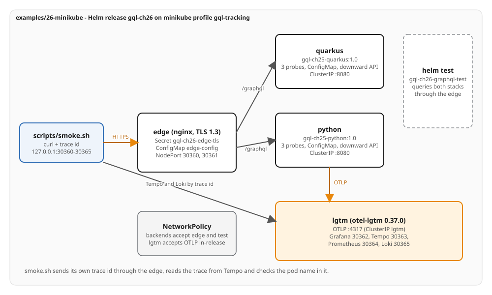

# Ch26 - Kubernetes on minikube

The tracking view of Chapter 25 as one Helm release on a minikube cluster. The release holds both stacks,
the nginx edge and the observability backend. The example carries no application code: it deploys
Chapter 25's images and is reached through NodePorts published on `127.0.0.1` when the profile is created.
The example has no `verify.sh`. A cluster is created once and kept, so the proof is `up.sh` (which ends with
`helm test`), then `smoke.sh`, then `down.sh`; the chart is also validated without a cluster.

## What it deploys

One chart, `helm/` (`gql-ch26-tracking` 1.0.0, app version 1.0), for namespace `gql-ch26`, release `gql-ch26`:

| Object | Source | Notes |
|---|---|---|
| Deployment, ClusterIP Service, ConfigMap per stack | `templates/stack-*.yaml`, range over `stacks` | `quarkus` and `python`; startup, readiness and liveness probes; downward API; `checksum/config` |
| Edge Deployment, NodePort Service, ConfigMap | `templates/edge-*.yaml` | nginx on `ubi10/nginx-126:10.2-1791973310`; TLS 1.3, 64k body limit, only `/graphql` |
| TLS Secret `gql-ch26-edge-tls` | `templates/tls-secret.yaml` | `genCA` and `genSignedCert`; `lookup` keeps it across upgrades |
| otel-lgtm Deployment, Services `lgtm` and `lgtm-ui` | `templates/lgtm-*.yaml` | `grafana/otel-lgtm:0.37.0`; OTLP on a ClusterIP, the UIs on NodePorts |
| NetworkPolicy per tier | `templates/networkpolicy.yaml` | backends accept the edge and the test pod |
| HorizontalPodAutoscaler per stack | `templates/hpa.yaml` | off by default |
| helm test pod | `templates/tests/test-graphql.yaml` | posts two queries to each stack through the edge with the chart's CA |

The chart sets no `runAsUser`, `runAsGroup` or `fsGroup`; `values.schema.json` rejects them. Selectors use
`app.kubernetes.io/name` and `instance` only.

## Layout

```
examples/26-minikube/
  helm/                  Chart.yaml, values.yaml, values.schema.json, ci-values-alt.yaml, templates/
  scripts/lib.sh         names, kc/hc wrappers that always name the cluster, preflight checks
  scripts/profile.sh     create, start or verify the profile gql-tracking (15 NodePorts)
  scripts/images.sh      docker build of Chapter 25's Containerfiles, minikube image load
  scripts/up.sh          profile.sh, images.sh, helm upgrade --install --wait, rollout status, helm test
  scripts/smoke.sh       the GraphQL assertions through 127.0.0.1:30360-30365
  scripts/down.sh        helm uninstall, delete the namespace, minikube stop
```

## Run it

Prerequisites: Docker Engine (context `default`), minikube v1.39.0 or newer, kubectl, Helm v4.3.1 or newer,
and Chapter 25's images buildable from `examples/25-docker-compose`. OpenShift Local and other minikube
profiles must be stopped; the scripts check and name what to stop.

```bash
examples/26-minikube/scripts/up.sh
examples/26-minikube/scripts/smoke.sh
examples/26-minikube/scripts/down.sh            # --keep-running leaves the profile running
```

`down.sh` stops the profile and keeps it. Deleting it is a command to run by hand:
`minikube delete -p gql-tracking`. `profile.sh --replace` deletes and recreates the profile, which is
only needed when the published port list changes.

Reach the release by hand:

```bash
kubectl --context gql-tracking -n gql-ch26 get secret gql-ch26-edge-tls -o jsonpath='{.data.ca\.crt}' | base64 -d > /tmp/ca.crt
curl --cacert /tmp/ca.crt -H 'Content-Type: application/json' -d '{"query":"{ __typename }"}' https://127.0.0.1:30360/graphql
xdg-open http://127.0.0.1:30362      # Grafana, anonymous Admin (lab only)
```

## Ports (NodePorts)

Host port, NodePort and target are one number, published on `127.0.0.1` at profile creation. The profile
publishes Chapter 26's six and Chapter 27's nine, because the list is fixed when the profile is created.

| Port | Target |
|---|---|
| 30360 | edge, HTTPS, Quarkus `/graphql` |
| 30361 | edge, HTTPS, Python `/graphql` |
| 30362 | Grafana |
| 30363 | Tempo |
| 30364 | Prometheus |
| 30365 | Loki |
| 30370-30378 | Chapter 27 |

## Static validation

No cluster is needed for these; CI runs the same commands (`k8s-manifests`).

```bash
helm lint --strict examples/26-minikube/helm
helm template gql-ch26 examples/26-minikube/helm -n gql-ch26 | kubeconform -strict -summary -kubernetes-version 1.37.1
helm template gql-ch26 examples/26-minikube/helm -n gql-ch26 -f examples/26-minikube/helm/ci-values-alt.yaml \
  | kubeconform -strict -summary -kubernetes-version 1.37.1
shellcheck -x examples/26-minikube/scripts/*.sh
```

Recorded on 2026-10-17 with Helm v4.3.1, kubeconform v0.8.0 (checksum verified), kubectl v1.37.1 and
ShellCheck v0.11.0:

| Check | Result |
|---|---|
| `helm lint --strict` | 1 chart linted, 0 failed |
| default render, `kubeconform -strict` at 1.37.1 | `Summary: 17 resources found parsing stdin - Valid: 17, Invalid: 0, Errors: 0, Skipped: 0` |
| `ci-values-alt.yaml` render (plain listeners, ClusterIP, no NetworkPolicy, HPAs) | `Summary: 15 resources found parsing stdin - Valid: 15, Invalid: 0, Errors: 0, Skipped: 0` |
| render with `edge.tls.enabled=false`, both Services ClusterIP | `Summary: 16 resources found parsing stdin - Valid: 16, Invalid: 0, Errors: 0, Skipped: 0` |
| ShellCheck on `scripts/*.sh` | no findings |

## Notes from the run

Recorded on 2026-10-17 on Fedora 44 with minikube v1.39.0, Docker Engine, containerd 2.3.4, Kubernetes
v1.37.1, the kindnet network plugin and Helm v4.3.1. minikube lists v1.37.0 as its newest preloaded version
and fetched v1.37.1 from the Kubernetes release list; the cluster reports v1.37.1.

- Profile creation took about 25 s after the preload; loading the four images (about 1.4 GB) took about two
  and a half minutes the first time. `up.sh` on a stopped profile with every image already built took
  2 min 44 s including `helm test`; `smoke.sh` took 37 s; `down.sh` took 33 s.
- The edge is nginx running as the image's own user with `/tmp` as an `emptyDir`; no other writable path
  is needed. The TLS volume is mounted read-only with mode `0444` (`defaultMode: 292`), readable by whichever user the cluster assigns, since the chart sets no `fsGroup`.
- The three probes answer for both stacks at the paths in `values.yaml`. otel-lgtm runs as root in its image,
  so its container has no `runAsNonRoot`; it keeps `allowPrivilegeEscalation: false`, all capabilities dropped
  and the runtime's default seccomp profile.
- kindnet enforces the NetworkPolicy: a pod without the edge or test label timed out (curl exit 28), and a
  pod labelled as the test pod got HTTP 200.
- Both SDKs read `OTEL_RESOURCE_ATTRIBUTES` as expanded from the downward API values. Tempo's trace holds
  `k8s.pod.name`, `k8s.namespace.name` and `k8s.node.name` on the resource of each stack's spans. The harness'
  span helpers read span attributes, so `smoke.sh` reads the resource attributes from Tempo's own JSON.
- `lookup` kept the certificate across a `helm upgrade`: the SHA-256 of the CA in the Secret is the same
  before and after.
- Quarkus' 8 source calls and Python's 6 for `FanOut` match Chapter 25.

Output of `helm test` (from `up.sh`):

```
TEST SUITE:     gql-ch26-graphql-test
Phase:          Succeeded

POD LOGS: gql-ch26-graphql-test (curl)
quarkus {"data":{"__typename":"Query"}}
quarkus {"data":{"cargo":{"trackingId":"ABC123","delivery":{"transportStatus":"ONBOARD_CARRIER"}}}}
python {"data":{"__typename":"Query"}}
python {"data":{"cargo":{"trackingId":"ABC123","delivery":{"transportStatus":"ONBOARD_CARRIER"}}}}
helm test: both stacks answer through the edge
```

Output of `smoke.sh` (the harness lines, with the long curl messages shortened):

```
=== the release: published ports, rollout, probes ===
ok docker port gql-tracking publishes 30360 on loopback: found '127.0.0.1:30360'
ok docker port gql-tracking publishes 30361 on loopback: found '127.0.0.1:30361'
ok docker port gql-tracking publishes 30362 on loopback: found '127.0.0.1:30362'
ok docker port gql-tracking publishes 30363 on loopback: found '127.0.0.1:30363'
ok docker port gql-tracking publishes 30364 on loopback: found '127.0.0.1:30364'
ok docker port gql-tracking publishes 30365 on loopback: found '127.0.0.1:30365'
ok docker port gql-tracking publishes 30370 on loopback: found '127.0.0.1:30370'
ok docker port gql-tracking publishes 30371 on loopback: found '127.0.0.1:30371'
ok docker port gql-tracking publishes 30372 on loopback: found '127.0.0.1:30372'
ok docker port gql-tracking publishes 30373 on loopback: found '127.0.0.1:30373'
ok docker port gql-tracking publishes 30374 on loopback: found '127.0.0.1:30374'
ok docker port gql-tracking publishes 30375 on loopback: found '127.0.0.1:30375'
ok docker port gql-tracking publishes 30376 on loopback: found '127.0.0.1:30376'
ok docker port gql-tracking publishes 30377 on loopback: found '127.0.0.1:30377'
ok docker port gql-tracking publishes 30378 on loopback: found '127.0.0.1:30378'
ok helm status gql-ch26: 'deployed'
ok the helm test pod: 'Succeeded'
ok deploy/lgtm is rolled out
ok deploy/quarkus is rolled out
ok deploy/python is rolled out
ok deploy/edge is rolled out
ok quarkus startupProbe path equals the value: '/q/health/started'
ok quarkus readinessProbe path equals the value: '/q/health/ready'
ok quarkus livenessProbe path equals the value: '/q/health/live'
ok python startupProbe path equals the value: '/health/live'
ok python readinessProbe path equals the value: '/health/ready'
ok python livenessProbe path equals the value: '/health/live'
ok quarkus runs one pod: '1'
ok python runs one pod: '1'
ok edge runs one pod: '1'
=== verifying stack 'quarkus' through the edge at https://127.0.0.1:30360/graphql ===
ok quarkus TrackCargo: no top-level errors
ok quarkus TrackCargo transportStatus: 'ONBOARD_CARRIER'
ok quarkus source-call log reset: '204'
ok quarkus FanOut: no top-level errors
ok quarkus FanOut returns Chapter 13's data: [["VWX901", [["V300A", "SGSIN", "CNSHA"]]], ["XYZ789", null], ["STU678", [["V300A", "SGSIN", "CNSHA"]]], ["D
ok quarkus FanOut: 8 source calls, read inside the pod: 8 call(s) to *.*
ok quarkus the booking index holds six cargos: '6'
ok quarkus ListCargos: six edges: '6'
ok quarkus ListCargos: GHI345's edge carries SERVICE_UNAVAILABLE: extensions.code is "SERVICE_UNAVAILABLE"
ok quarkus ListCargos: the exposed message: message at ["cargos","edges",5,"node"] is 'booking service unavailable'
ok quarkus ListCargos: 6 errors: 6 error(s)
ok quarkus: /debug/source-calls is not routed: '404'
ok quarkus: /q/health/ready is not routed: '404'
ok quarkus: /health/ready is not routed: '404'
ok quarkus: / is not routed: '404'
ok quarkus: without the CA the certificate is untrusted: curl failed as expected (exit 60)
ok quarkus: a TLS 1.2 client is refused: curl failed as expected (exit 35)
ok quarkus: a TLS 1.3 client is served: '200'
ok quarkus source-call log reset: '204'
ok quarkus: a 100 KB body is refused at the edge: '413'
ok quarkus: the refused body never reached the pod: 0 call(s) to *.*
ok quarkus Itinerary.finalArrivalDate: Itinerary.finalArrivalDate is deprecated ('Use `finalArrivalTime`.')
ok quarkus schema vs contracts/schema: live schema conforms to the canonical SDL (slice)
=== verifying stack 'python' through the edge at https://127.0.0.1:30361/graphql ===
ok python TrackCargo: no top-level errors
ok python TrackCargo transportStatus: 'ONBOARD_CARRIER'
ok python source-call log reset: '204'
ok python FanOut: no top-level errors
ok python FanOut returns Chapter 13's data: [["VWX901", [["V300A", "SGSIN", "CNSHA"]]], ["XYZ789", null], ["STU678", [["V300A", "SGSIN", "CNSHA"]]], ["DE
ok python FanOut: 6 source calls, read inside the pod: 6 call(s) to *.*
ok python the booking index holds six cargos: '6'
ok python ListCargos: six edges: '6'
ok python ListCargos: GHI345's edge carries SERVICE_UNAVAILABLE: extensions.code is "SERVICE_UNAVAILABLE"
ok python ListCargos: the exposed message: message at ["cargos","edges",5,"node"] is 'booking service unavailable'
ok python ListCargos: 1 errors: 1 error(s)
ok python: /debug/source-calls is not routed: '404'
ok python: /q/health/ready is not routed: '404'
ok python: /health/ready is not routed: '404'
ok python: / is not routed: '404'
ok python: without the CA the certificate is untrusted: curl failed as expected (exit 60)
ok python: a TLS 1.2 client is refused: curl failed as expected (exit 35)
ok python: a TLS 1.3 client is served: '200'
ok python source-call log reset: '204'
ok python: a 100 KB body is refused at the edge: '413'
ok python: the refused body never reached the pod: 0 call(s) to *.*
ok python Itinerary.finalArrivalDate: Itinerary.finalArrivalDate is deprecated ('Use `finalArrivalTime`.')
ok python schema vs contracts/schema: live schema conforms to the canonical SDL (slice)
=== quarkus: the pod is named in the trace ===
ok quarkus: extensions.traceId equals the id sent through the edge: extensions.traceId is "14d6ffd026bf23a05da7303b53bac64d"
ok quarkus: Tempo holds the operation span for that id: /^query ListCargos$/ occurs 1..1 time(s)
ok quarkus: the trace carries one k8s.pod.name: '1'
ok quarkus: k8s.pod.name is a pod of the Deployment: found 'quarkus-588766b5bf-dxv9z'
ok quarkus: Loki holds a record for trace 14d6ffd026bf23a05da7303b53bac64d
=== python: the pod is named in the trace ===
ok python: extensions.traceId equals the id sent through the edge: extensions.traceId is "d7e6bf9fa859ba51a7854c4793935438"
ok python: Tempo holds the operation span for that id: /^GraphQL Query: ListCargos$/ occurs 1..1 time(s)
ok python: the trace carries one k8s.pod.name: '1'
ok python: k8s.pod.name is a pod of the Deployment: found 'python-84f779f599-v9nm9'
ok python: Loki holds a record for trace d7e6bf9fa859ba51a7854c4793935438
=== NetworkPolicy: the stacks accept the edge and the test pod ===
ok a pod without the edge or test label times out against quarkus:8080: found 'rc=28'
ok a pod labelled as the test pod reaches quarkus:8080: found '200 rc=0'
=== a configuration change rolls only the pods that read it ===
ok python checksum/config changed
ok the python pod was replaced (python-84f779f599-v9nm9 -> python-85c6974b86-cmmcb)
ok the new pod runs with TRACKING_SOURCE_LATENCY_MS=100: '100'
ok quarkus checksum/config is unchanged: '8c0a46f82eea9a1b1cc5b388396e6e501478ab8f1ae46ab72ea77f0195bd1bb1'
ok the quarkus pod was not replaced: 'quarkus-588766b5bf-dxv9z'
ok the upgrade kept the edge certificate (lookup): '9e624d98a30bb9e60bda85b10d03418e3d952778d59518949627fb9a4ab42b53'
ok the value is back to 250: '250'
PASS - Ch26 Kubernetes on minikube: the release is deployed and tested; both stacks answer through the edge NodePorts with Chapter 25's results; the edge refuses a 100 KB body with 413, serves TLS 1.3 only and routes only /graphql; a trace id sent through the edge is found in the error, in Tempo and in Loki, and the trace names the pod; a stranger pod is refused by the NetworkPolicy; a configuration change rolls only the pods that read it.
smoke.sh: 9.07s user 1.91s system 29% cpu 37.460 total
```

## Diagram



`architecture.excalidraw` is the editable source; the spec is `diagrams/examples/26-minikube-architecture.py`.
