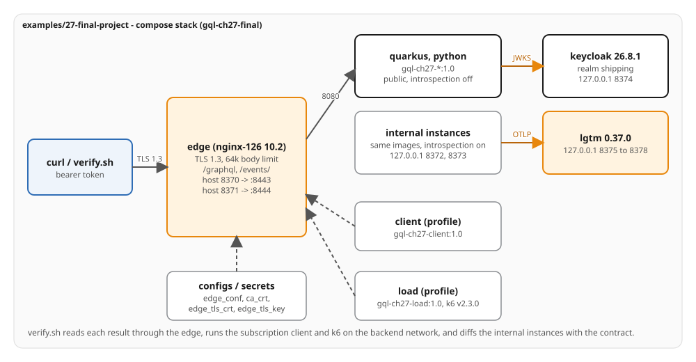

# Ch27 - The final project

The complete tracking view behind one edge. Both stacks serve the whole canonical schema, `Subscription`
included, from the images `gql-ch27-quarkus:1.0` and `gql-ch27-python:1.0`. An nginx edge terminates TLS 1.3,
refuses bodies over 64k and routes only `/graphql` and `/events/`. Keycloak issues the tokens. Each stack
authorizes by operation, by object and by field on queries, on subscriptions and on the event feed. Query
limits refuse a document before any source is asked. Introspection is on only for the internal instances.
`verify.sh` ends with a two-run k6 load through the edge.

## The served slice

`contracts/schema/shipping/*.graphql` is the canonical SDL, and this chapter serves all of it:
`assert_sdl_equals` compares each internal instance with it in both directions, and the SDL is unchanged.
The seed is Chapter 13's; the ownership is Chapter 18's (`ana` ACME owns VWX901, DEF456 and ABC123; `bo` GLOBEX
owns XYZ789, STU678 and GHI345; `ops` is an operator). `GHI345` fails at the booking source with
`SERVICE_UNAVAILABLE`. The first registration is `evt_10`.

## What the final project carries

| From | In this example |
|---|---|
| Chapter 13 | the seed, the batched sources and the source-call log (a lab endpoint the edge does not route) |
| Chapter 14 | depth, token, alias and cost limits; the cost budget is 1000 |
| Chapter 17 | introspection off on the public instances, on for the internal ones: `TRACKING_INTROSPECTION_ENABLED` (Quarkus), `TRACKING_PUBLIC` (Python) |
| Chapter 18 | Keycloak 26.8.1, bearer validation (`quarkus-oidc`; PyJWT with `PyJWKClient`), operation, object and field authorization |
| Chapter 19 and 24 | traces, metrics and logs by trace id; `extensions.traceId` on execution errors |
| Chapter 21 | `Subscription.cargoHandled` over `graphql-transport-ws` (both stacks), GraphQL over SSE (Python), the event feed `GET /events/cargos/{trackingId}` (both) |
| Chapter 23 | the k6 image and the `FanOut` and `OverBudget` documents, reduced to two runs |
| Chapter 25 | the edge, the networks, the health split, limits, configs and secrets |

Each ported file keeps its chapter's header comment, so the origin of a class or module reads from its first
line. Chapter 17's in-process TLS is not ported: the edge terminates TLS. Persisted documents (15), caching
(16), federation (20), the client chapters and the dev instances of Chapter 24 stay in their own chapters.

## The tier

| Service | Image | Networks | Published |
|---|---|---|---|
| `edge` | `registry.access.redhat.com/ubi10/nginx-126:10.2-1791973310` | `public`, `backend` | `8370` -> 8443, `8371` -> 8444 |
| `quarkus` | `gql-ch27-quarkus:1.0` (`ubi10/openjdk-25-runtime:1.24-16`) | `backend` | none |
| `python` | `gql-ch27-python:1.0` (`ubi10/python-314-minimal:10.2-1791928506`) | `backend` | none |
| `quarkus-internal` | the same image as `quarkus` | `backend`, `ops` | `127.0.0.1:8372` |
| `python-internal` | the same image as `python` | `backend`, `ops` | `127.0.0.1:8373` |
| `keycloak` | `quay.io/keycloak/keycloak:26.8.1` | `backend`, `ops` | `127.0.0.1:8374` |
| `lgtm` | `docker.io/grafana/otel-lgtm:0.37.0` | `backend`, `ops` | `127.0.0.1` 8375 to 8378 |
| `client` (profile) | `gql-ch27-client:1.0` (`gql[websockets]` 4.4.0) | `backend` | none |
| `load` (profile) | `gql-ch27-load:1.0` (`grafana/k6` v2.3.0 on `ubi10/ubi-minimal:10.2-1791891203`) | `backend` | none |

`backend` is `internal: true`. Start order: `lgtm` and `keycloak`, then the four application instances, then
`edge`, each by `depends_on` with `condition: service_healthy`. Limits as in Chapter 25: Quarkus `1.0` CPU and
`768m`, Python `0.5` and `384m`, edge `0.25` and `64m`; every service has `restart: unless-stopped`, a 15 s
stop grace period and rotated `local` logs.

### Environment contract

The same keys configure the compose tier, the cluster tier and any other: only their values change.

| Name | Stack | Value here |
|---|---|---|
| `OTEL_EXPORTER_OTLP_ENDPOINT` | both | `http://lgtm:4317` |
| `QUARKUS_OTEL_SERVICE_NAME` / `OTEL_SERVICE_NAME` | Quarkus / Python | `ch27-final-quarkus` / `ch27-final-python`; `-internal` on the internal instances |
| `QUARKUS_OIDC_AUTH_SERVER_URL` / `TRACKING_OIDC_JWKS_URL` | Quarkus / Python | where the signing keys are read: `http://keycloak:8080/realms/shipping` and its `protocol/openid-connect/certs` |
| `QUARKUS_OIDC_TOKEN_ISSUER` / `TRACKING_OIDC_ISSUER` | Quarkus / Python | the issuer the tokens carry: `http://localhost:8374/realms/shipping` |
| `TRACKING_INTROSPECTION_ENABLED` / `TRACKING_PUBLIC` | Quarkus / Python | `false` / `true` on the public instances; unset on the internal ones |
| `TRACKING_SOURCE_LATENCY_MS` | both | `250` |
| `TRACKING_DEBUG_ENDPOINTS` | both | `true` (lab; the edge does not route `/debug`) |
| `TRACKING_QUERY_MAX_COST` / `TRACKING_MAX_QUERY_COST` | Quarkus / Python | the cost budget; default `1000` |

### Edge

`edge/nginx.conf` is the compose config `edge_conf`. `ssl_protocols TLSv1.3`; certificate and key from
`/run/secrets/edge_tls_crt` and `edge_tls_key`; `client_max_body_size 64k`; `location = /graphql` (queries,
mutations and the WebSocket upgrade, through the `Upgrade`/`Connection` map) and `location /events/` (with
`proxy_buffering off`) are proxied, every other path answers `404`. Each upstream is resolved per request
through Docker's DNS (`resolver 127.0.0.11 valid=10s`), so a restarted container is found at its new address.
`Authorization` and `traceparent` pass through unchanged. `gen-certs.sh <dir>` writes a CA, `edge.crt` and
`edge.key` (two days, SANs `localhost`, `edge`, `127.0.0.1`); compose reads them from `${CERT_DIR:-./certs}`,
and the client and load services trust the CA through `SSL_CERT_FILE`.

## Run it

```bash
bash examples/27-final-project/verify.sh
```

`verify.sh` generates certificates into a scratch directory, brings the project up, runs every case on both
stacks, diffs each internal schema with `contracts/schema/`, runs the two k6 loads and tears the project
down. It prints `PASS` only if every check holds on both stacks. It needs Docker Engine with the
`docker compose` plugin and Node/npm (for the pinned `graphql-inspector` in `contracts/`). It needs about 5 GB
of memory.

To explore by hand:

```bash
examples/27-final-project/gen-certs.sh examples/27-final-project/certs
docker compose -f examples/27-final-project/compose.yaml up -d --build --wait
TOKEN=$(curl -s -d 'grant_type=password&client_id=tracking-cli&username=ops&password=ops-fixture-pw' \
  http://localhost:8374/realms/shipping/protocol/openid-connect/token | python3 -c 'import json,sys; print(json.load(sys.stdin)["access_token"])')
curl -s --cacert examples/27-final-project/certs/ca.crt https://localhost:8371/graphql \
  -H "Authorization: Bearer $TOKEN" -H 'Content-Type: application/json' -d '{"query":"{ cargos(first: 10) { totalCount } }"}'
docker compose -f examples/27-final-project/compose.yaml down -v
```

The subscription client and the load runner sit behind compose profiles and run on the backend network:

```bash
docker compose -f examples/27-final-project/compose.yaml run --rm -e TOKEN="$TOKEN" client \
  --url wss://edge:8444/graphql --tracking-id ABC123 --count 1 --frames
docker compose -f examples/27-final-project/compose.yaml run --rm \
  -e RUN=fanout -e TARGET=https://edge:8444/graphql -e STACK=python -e TOKEN="$TOKEN" load
```

## Ports

| Service | Container | Host | Endpoint |
|---|---|---|---|
| edge, Quarkus | 8443 | 8370 | `https://localhost:8370/graphql`, `/events/` |
| edge, Python | 8444 | 8371 | `https://localhost:8371/graphql`, `/events/` |
| quarkus-internal | 8080 | 127.0.0.1:8372 | `http://localhost:8372/graphql` (introspection on) |
| python-internal | 8080 | 127.0.0.1:8373 | `http://localhost:8373/graphql` (introspection on) |
| Keycloak | 8080 | 127.0.0.1:8374 | `/realms/shipping`, the issuer |
| Grafana | 3000 | 127.0.0.1:8375 | UI, anonymous Admin (lab only) |
| Tempo | 3200 | 127.0.0.1:8376 | `/api/traces/<trace id>` |
| Prometheus | 9090 | 127.0.0.1:8377 | `/api/v1/query` |
| Loki | 3100 | 127.0.0.1:8378 | `/loki/api/v1/query_range` |

Compose project `gql-ch27-final`, containers `ch27-final-*`.

## On the wire

Each value below is asserted by `verify.sh`.

| Case | Quarkus | Python |
|---|---|---|
| services | seven `healthy` (the profiles are not started) | the same |
| `quarkus`, `python` ports | no host binding (`docker compose port` prints nothing or `:0`) and `PortBindings` `{}` or `null`; network `backend` only | the same |
| other ports | `127.0.0.1` only; the edge 8370 and 8371 | the same |
| contract | `assert_sdl_equals` on 8372; `Itinerary.finalArrivalDate` deprecated | on 8373 |
| public introspection, as `ops` | no data; `Introspection has been disabled for this request` | no data; `introspection has been disabled` |
| TLS and body | TLS 1.2 and an unknown CA fail; 100 KB body `413`, no source call | the same |
| routes | `/debug/source-calls`, `/debug/subscribers`, `/q/health/ready`, `/health/ready` `404` | the same |
| anonymous `cargo(ABC123)` | `data.cargo` null; `UNAUTHENTICATED` at `["cargo"]`, `authentication required`; 0 source calls | the same |
| token for `other-cli` | `401`, `WWW-Authenticate: Bearer`, empty body | `401`, `Bearer error="invalid_token"`, `{"detail":"invalid token"}` |
| `ops` `TrackCargo` ABC123 | `ONBOARD_CARRIER` | the same |
| `ana` `cargos(first: 10)` | VWX901, DEF456, ABC123; `totalCount` 3 | the same |
| `bo` `cargo(ABC123)` | null, no error | the same |
| `ana` `registrationTime` | `FORBIDDEN` at the field, edge `node` null | the same |
| `OverBudget`, anonymous | no data; `maximum query complexity exceeded 7651 > 1000`; 0 calls | the same |
| `D_DEEP` | `maximum query depth exceeded 16 > 15` | `exceeds maximum operation depth of 14` |
| 150 aliases | `150 aliases found. Allowed: 20` | the same |
| `FanOut` as `ops` | VWX901, XYZ789, STU678, DEF456; 8 calls | the same data; 6 calls |
| subscription, anonymous / `bo` | error message `UNAUTHENTICATED` / `FORBIDDEN`, `not permitted to watch this cargo`; no subscriber | the same |
| subscription, bad token | the upgrade is refused | the same |
| `REG_F1` as `ops` | `evt_10`, no `userErrors` | the same |
| `ana` Watch | one `next`: `evt_10`, Hamburg, `IN_PORT`; frames init, ack, subscribe, next, complete | the same |
| `ana` Audit | `next` with two `FORBIDDEN` at `registrationTime`, both history nodes null | the same |
| `ops` Audit | `next` with both `registrationTime` values | the same |
| graphql-sse | not served | one `next` with `evt_10` for `ana` |
| event feed | `ana` from `Last-Event-ID: evt_9` gets `evt_10`; no token `401`; `bo` `403` | the same |
| subscribers after | 0 on both channels | 0 |
| `extensions.traceId` | equals the sent id; `query ListCargos`; a Loki record by `trace_id` | `GraphQL Query: ListCargos`; the same |
| k6 `fanout` | 80 iterations, every check true, `http_req_failed` 0; 80 request ids, 8 calls each | 80, 6 calls each |
| k6 `cost` | 80 iterations (40 `FanOut`, 40 `OverBudget`); 40 request ids with calls | the same |

## Code-first notes

Pinned versions: Quarkus 3.40.1, Strawberry 0.335.0, FastAPI 0.143.2, PyJWT 2.15.1, uv 0.13.1, Keycloak 26.8.1,
`grafana/otel-lgtm` 0.37.0, k6 v2.3.0, `ubi10/nginx-126` `10.2-1791973310`. The Python project is
`shipping-python-ch27-final` with its own `uv.lock`; the Quarkus artifact is `ch27-quarkus-final`.

**One image, two kinds of instance.** The public and internal instances differ only in environment. On
Quarkus `IntrospectionSwitch` calls graphql-java's `Introspection.enabledJvmWide(false)` at start; on Python
`schema_for(public)` adds `DisableIntrospection` and `disable_field_suggestions`, and the router takes GET
queries only on an internal instance. `quarkus.smallrye-graphql.schema-available=false` closes the schema
document on both kinds.

**Limits.** Quarkus appends the cost budget and the alias limit to SmallRye's instrumentation chain (`QueryCost`)
and sets the depth limit with `quarkus.smallrye-graphql.instrumentation-query-depth=15`. Python lists
`MaxTokensLimiter`, the depth and alias rules and `QueryCostLimiter` in the schema's extensions, between
`MaskErrors` and the telemetry extensions. The limits run before any resolver, so they apply to an anonymous
caller.

**Identity on a WebSocket.** The client sends `Authorization: Bearer ...` on the upgrade request, and the edge
passes it through. Quarkus authenticates the upgrade with `quarkus-oidc` like any HTTP request. Python reads
the header from the `WebSocket` connection in the same FastAPI dependency that reads it from a `Request`
(`get_identity` takes a Starlette `HTTPConnection`); a token that does not validate refuses the upgrade.

**Admission, once.** Chapter 18's operation and object rules apply when a subscription starts. On Python they
are Strawberry permission classes on the field: `IsAuthenticated`, then `CanWatchCargo`, which reuses
`access.visible`. On Quarkus `SubscriptionGate` is a graphql-java instrumentation installed in the same
`GraphQL.Builder` chain as the cost limits and the loader reset; it runs the same two checks while the engine
creates the event stream, so a refusal reaches the client as an error message with the code. An unknown cargo
and another shipper's cargo are refused alike.

**Fields, on every event.** An event is executed as the subscriber. Python keeps the subscriber's `Identity` in
the connection's context, so `IsOperator` on `registrationTime` answers for the subscriber. On Quarkus
`SubscriberIdentity` delivers each event in a request context that holds the subscriber's `SecurityIdentity`,
taken when the subscription starts, so each event runs with the subscriber's identity; `@RolesAllowed("operator")` and `Viewers`
then answer for the subscriber, including in the continuations that run after a source's latency. The Audit
document reaches `registrationTime` through `cargo.handlingHistory`, under nullable parents (`cargoHandled` and `registrationTime` are non-null, so a refusal's null climbs to the nearest nullable parent, Chapter 4), so a caller
without the role gets the event with the refused fields as errors.

**The event feed.** `GET /events/cargos/{trackingId}` is `401` without a token and `403` for a cargo the caller
may not see, checked before the stream starts: `@Authenticated` and a `BookingSource.mayWatch` check on
Quarkus, a route dependency on Python.

**Tokens.** `verify.sh` fetches tokens at `localhost:8374`, the address Keycloak is published on, which is the
issuer both stacks pin. The realm file is Chapter 18's, unchanged.

**Load.** `tracking.js` ends with `handleSummary` returning k6's own summary object on one stdout line, which
is the shape `run_load` in `examples/_lib/lib.sh` reads (`metrics.iterations.values.count` and
`metrics.checks.values.rate`). The k6 container trusts the lab CA through `SSL_CERT_FILE`, so the runs go
through the edge over TLS. `documents/fan-out.graphql` and `documents/over-budget.graphql` are byte-equal to
Chapter 23's; `verify.sh` checks that first.

**Debug endpoints.** `/debug/source-calls` and `/debug/subscribers` are read inside the containers
(`compose_exec_http`, `source_calls_in`); the edge does not route them.

## On Kubernetes

The same three images run on the minikube profile `gql-tracking` of Chapter 26, deployed by one Helm release
that is Chapter 26's chart extended. The example's `helm/` and `scripts/` carry no application code: the
images are the compose tier's, `images.sh` builds them with the same Containerfiles, and `up.sh`, `smoke.sh`
and `down.sh` run the release.

```
helm/
  Chart.yaml  values.yaml  values.schema.json  ci-values-alt.yaml  ci-values-appendix-a.yaml
  files/shipping-realm.json             the realm of Chapter 18, mounted into Keycloak from a ConfigMap
  templates/
    instance-{configmap,deployment,service}.yaml   one of each per stack and per instance (public, internal)
    edge-{configmap,deployment,service}.yaml  tls-secret.yaml
    keycloak-{configmap,secret,deployment,service}.yaml
    lgtm-{deployment,service}.yaml  networkpolicy.yaml  hpa.yaml  NOTES.txt  tests/test-graphql.yaml
scripts/
  lib.sh  profile.sh  images.sh  up.sh  smoke.sh  down.sh
```

What the chart adds to Chapter 26's:

- Each entry of `stacks` has `instances`: `public` (introspection off, a ClusterIP Service named `quarkus` or
  `python`, the edge's upstream) and `internal` (the same image with introspection on, `quarkus-internal` or
  `python-internal`, a NodePort). The environment of an instance is the stack's `env`, the `introspectionOff`
  keys for an instance that has it off (`TRACKING_INTROSPECTION_ENABLED` on Quarkus, `TRACKING_PUBLIC` on
  Python), the `identity` values under the names the stack reads them as, and the instance's own `env`.
- `identity.issuer` is `http://localhost:30374/realms/shipping`, the address a client fetches tokens at, and
  `identity.authServerUrl` is `http://keycloak:8080/realms/shipping`, where the stacks read the signing keys.
- Keycloak 26.8.1 runs `start-dev --import-realm` with the realm from a ConfigMap, probes on its management
  port 9000 (`/health/started`, `/health/ready`, `/health/live`), and `emptyDir` volumes for its data and `/tmp`.
- The edge routes `/graphql` (with the upgrade) and `/events/`. It finds the backends through the Services
  `quarkus` and `python`: nginx resolves each name once, when it starts, through the cluster's DNS, and a
  Service keeps its ClusterIP for as long as it exists, so a rescheduled pod is reached at the same address.
- The NetworkPolicies let the public instances accept the edge and the test pod, the internal instances and
  Keycloak accept any source on 8080, the edge any source on its ports, and the observability backend accept
  OTLP from the release's pods.
- The Ch26 patterns stay: `values.schema.json` is enforced (the public instance cannot enable introspection, and
  `runAsUser`, `runAsGroup` and `fsGroup` are rejected), a `checksum/config` annotation on every instance, a
  chart-generated TLS Secret kept across upgrades with `lookup`, three probes per workload, the downward API
  in `OTEL_RESOURCE_ATTRIBUTES`, restricted security contexts with no UID, and `helm test`.

### Run it

```bash
examples/27-final-project/scripts/up.sh       # profile.sh, images.sh, helm upgrade --install, rollout status, helm test
examples/27-final-project/scripts/smoke.sh    # the defences, through the NodePorts
examples/27-final-project/scripts/down.sh     # helm uninstall, delete the namespace, minikube stop -p gql-tracking
```

`profile.sh` runs Chapter 26's, which creates or starts `gql-tracking` and checks with `docker port` that all
fifteen NodePorts are published on `127.0.0.1`. The scripts refuse to run while OpenShift Local or another
minikube profile is running, name every call's cluster (`--context`, `--kube-context`, `-p gql-tracking`) and
never delete the profile. `smoke.sh` registers `REG_F1`, so it runs once per release: run `down.sh` and `up.sh`
again for another pass.

### NodePorts

| Port | Target |
|---|---|
| 30370 | edge, HTTPS, Quarkus `/graphql` and `/events/` |
| 30371 | edge, HTTPS, Python `/graphql` and `/events/` |
| 30372 | `quarkus-internal` (introspection on) |
| 30373 | `python-internal` (introspection on) |
| 30374 | Keycloak, the issuer |
| 30375 to 30378 | Grafana, Tempo, Prometheus, Loki |

Tokens are fetched at `http://localhost:30374`, so they carry the issuer the stacks compare with. Release
`gql-ch27`, namespace `gql-ch27`.

### Static validation

No cluster is needed for these; CI runs the same commands (`k8s-manifests`).

```bash
helm lint --strict examples/27-final-project/helm
helm template gql-ch27 examples/27-final-project/helm -n gql-ch27 | kubeconform -strict -summary -kubernetes-version 1.37.1
helm template gql-ch27 examples/27-final-project/helm -n gql-ch27 -f examples/27-final-project/helm/ci-values-alt.yaml \
  | kubeconform -strict -summary -kubernetes-version 1.37.1
helm template gql-ch27 examples/27-final-project/helm -n gql-ch27 -f examples/27-final-project/helm/ci-values-appendix-a.yaml \
  | kubeconform -strict -summary -kubernetes-version 1.37.1
shellcheck -x examples/27-final-project/scripts/*.sh
```

Recorded on 2026-10-17 with Helm v4.3.1, kubeconform v0.8.0, kubectl v1.37.1 and ShellCheck v0.11.0:

| Check | Result |
|---|---|
| `helm lint --strict` | 1 chart linted, 0 failed |
| default render, `kubeconform -strict` at 1.37.1 | `Summary: 29 resources found parsing stdin - Valid: 29, Invalid: 0, Errors: 0, Skipped: 0` |
| `ci-values-alt.yaml` (plain listeners, ClusterIP, no NetworkPolicy, HPAs) | `Summary: 25 resources found parsing stdin - Valid: 25, Invalid: 0, Errors: 0, Skipped: 0` |
| `ci-values-appendix-a.yaml` (the wrapper's `final:` values: no edge TLS, every Service ClusterIP, IfNotPresent, image-stream paths, the Route issuer, Keycloak proxy headers, the lgtm service account and no seccomp profile) | `Summary: 28 resources found parsing stdin - Valid: 28, Invalid: 0, Errors: 0, Skipped: 0` |
| `--set edge.tls.enabled=false`, edge and lgtm Services ClusterIP (the CI form) | `Summary: 28 resources found parsing stdin - Valid: 28, Invalid: 0, Errors: 0, Skipped: 0` |
| ShellCheck on `scripts/*.sh` | no findings |

The chart renders no `route.openshift.io`, `build.openshift.io`, `image.openshift.io` or
`security.openshift.io` object, and no `runAsUser`, `runAsGroup` or `fsGroup`.

### Notes from the run

Recorded on 2026-10-17 on Fedora 44 with minikube v1.39.0, Docker Engine, containerd 2.3.4, Kubernetes v1.37.1
and Helm v4.3.1. minikube lists v1.37.0 as its newest preloaded version and fetches v1.37.1 from the Kubernetes
release list; the node reports v1.37.1.

- `up.sh` on the stopped profile took 3 min 47 s, which includes building and loading the four images of this
  chapter and `helm test`; `smoke.sh` took 57 s; `down.sh` took 52 s and left `gql-tracking` stopped, with its
  images in the node.
- Seven Deployments reach `Running` and ready: `lgtm`, `keycloak`, `quarkus`, `python`, `quarkus-internal`,
  `python-internal` and `edge`.
- A token fetched through the Keycloak NodePort at `localhost:30374` carries the issuer
  `http://localhost:30374/realms/shipping`, and both stacks accept it. A token fetched at `127.0.0.1` carries
  that address as its issuer instead, so the smoke script uses the host name `localhost`.
- Keycloak starts under the restricted context with the image's own user: its data directory and `/tmp` are
  `emptyDir` volumes, and the realm file is mounted under `data/import`.
- A client and a k6 run execute as pods in the namespace from `gql-ch27-client:1.0` and `gql-ch27-load:1.0`,
  trust the chart's CA through a Secret volume and `SSL_CERT_FILE`, and reach the edge as `edge:8443` and
  `edge:8444`. The k6 pod prints k6's summary object as its last log line.
- The edge reaches the stacks at their Service names, and the trace of a request through the edge names the pod
  of the public instance in `k8s.pod.name`.

Output of `helm test` (from `up.sh`):

```
TEST SUITE:     gql-ch27-graphql-test
Phase:          Succeeded

POD LOGS: gql-ch27-graphql-test (curl)
quarkus {"data":{"__typename":"Query"}}
quarkus {"errors":[{"message":"authentication required","locations":[{"line":1,"column":3}],"path":["cargo"],"extensions":{"code":"UNAUTHENTICATED","traceId":"045c00592cda375d353dfbeaaad30704"}}],"data":{"cargo":null}}
quarkus /debug/source-calls 404
python {"data":{"__typename":"Query"}}
python {"data":{"cargo":null},"errors":[{"message":"authentication required","locations":[{"line":1,"column":3}],"path":["cargo"],"extensions":{"code":"UNAUTHENTICATED","traceId":"f02723048f55e59b9a61e83b8ffe5baf"}}]}
python /debug/source-calls 404
helm test: both stacks answer through the edge and keycloak serves the realm
```

Output of `smoke.sh` (the harness lines, with the NodePort checks for 30360 to 30378 left out and long messages shortened):

```
=== the release: published ports, rollout ===
ok - helm status gql-ch27: 'deployed'
ok - the helm test pod: 'Succeeded'
ok - deploy/lgtm is rolled out
ok - deploy/keycloak is rolled out
ok - deploy/quarkus is rolled out
ok - deploy/python is rolled out
ok - deploy/quarkus-internal is rolled out
ok - deploy/python-internal is rolled out
ok - deploy/edge is rolled out
=== tokens from Keycloak at the NodePort, the issuer the stacks pin ===
=== verifying stack 'quarkus' through the edge at https://127.0.0.1:30370/graphql ===
ok - quarkus internal schema equals the canonical SDL: live schema equals the canonical SDL
ok - quarkus Itinerary.finalArrivalDate: Itinerary.finalArrivalDate is deprecated ('Use `finalArrivalTime`.')
ok - quarkus public __schema is refused, even for an operator: 1 top-level error(s)
ok - quarkus public __schema returns no data: no data
ok - quarkus public __schema message: an error message contains 'Introspection has been disabled for this request'
ok - quarkus: a TLS 1.2 client is refused: curl failed as expected (exit 35: (35) TLS connect error: error:0A00042E:SSL routines::tlsv1 alert protocol version)
ok - quarkus source-call log reset: '204'
ok - quarkus: a 100 KB body is refused at the edge: '413'
ok - quarkus: the refused body never reached the pod: 0 call(s) to *.*
ok - quarkus: /debug/source-calls is not routed: '404'
ok - quarkus anonymous cargo: code: extensions.code is "UNAUTHENTICATED"
ok - quarkus a token for another audience is HTTP 401 through the edge: '401'
ok - quarkus ana cargos: no top-level errors
ok - quarkus ana sees her three cargos: ["VWX901", "DEF456", "ABC123"]
ok - quarkus ana registrationTime: code: extensions.code is "FORBIDDEN"
ok - quarkus source-call log reset: '204'
ok - quarkus OverBudget: no data: no data
ok - quarkus OverBudget: message: 'maximum query complexity exceeded 7651 > 1000'
ok - quarkus OverBudget: refused before any source call: 0 call(s) to *.*
ok - quarkus source-call log reset: '204'
ok - quarkus FanOut as ops: no top-level errors
ok - quarkus FanOut: 8 source calls, read inside the pod: 8 call(s) to *.*
--- quarkus: one subscription event, delivered to a client in the cluster
ok - quarkus REG_F1: no top-level errors
ok - quarkus REG_F1 is evt_10: 'evt_10'
ok - quarkus the client printed exactly one event: '1'
ok - quarkus ana's event is evt_10: 'evt_10'
ok - quarkus ana's event delivery, read after the unload: 'IN_PORT'
--- quarkus: one k6 run through the edge
ok - quarkus source-call log reset: '204'
ok - quarkus k6 fanout: iterations: '80'
ok - quarkus k6 fanout: every check true: '1'
ok - quarkus k6 fanout: no transport failure: '0'
ok - quarkus k6 fanout: one request id per request: 80 distinct request id(s)
ok - quarkus k6 fanout: 8 calls per request: every request made 8 call(s)
ok - quarkus: extensions.traceId equals the id sent through the edge: extensions.traceId is "6f66e61e431121dcab5a379fa2a7946f"
ok - quarkus: Tempo holds the operation span for that id: /^query ListCargos$/ occurs 1..1 time(s)
ok - quarkus: the trace carries one k8s.pod.name: '1'
ok - quarkus: k8s.pod.name is the public instance's pod: found 'quarkus-6d987589cd-p8kzp'
ok - quarkus: Loki holds a record for trace 6f66e61e431121dcab5a379fa2a7946f
=== verifying stack 'python' through the edge at https://127.0.0.1:30371/graphql ===
ok - python internal schema equals the canonical SDL: live schema equals the canonical SDL
ok - python Itinerary.finalArrivalDate: Itinerary.finalArrivalDate is deprecated ('Use `finalArrivalTime`.')
ok - python public __schema is refused, even for an operator: 2 top-level error(s)
ok - python public __schema returns no data: no data
ok - python public __schema message: an error message contains 'introspection has been disabled'
ok - python: a TLS 1.2 client is refused: curl failed as expected (exit 35: (35) TLS connect error: error:0A00042E:SSL routines::tlsv1 alert protocol version)
ok - python source-call log reset: '204'
ok - python: a 100 KB body is refused at the edge: '413'
ok - python: the refused body never reached the pod: 0 call(s) to *.*
ok - python: /debug/source-calls is not routed: '404'
ok - python anonymous cargo: code: extensions.code is "UNAUTHENTICATED"
ok - python a token for another audience is HTTP 401 through the edge: '401'
ok - python ana cargos: no top-level errors
ok - python ana sees her three cargos: ["VWX901", "DEF456", "ABC123"]
ok - python ana registrationTime: code: extensions.code is "FORBIDDEN"
ok - python source-call log reset: '204'
ok - python OverBudget: no data: no data
ok - python OverBudget: message: 'maximum query complexity exceeded 7651 > 1000'
ok - python OverBudget: refused before any source call: 0 call(s) to *.*
ok - python source-call log reset: '204'
ok - python FanOut as ops: no top-level errors
ok - python FanOut: 6 source calls, read inside the pod: 6 call(s) to *.*
--- python: one subscription event, delivered to a client in the cluster
ok - python REG_F1: no top-level errors
ok - python REG_F1 is evt_10: 'evt_10'
ok - python the client printed exactly one event: '1'
ok - python ana's event is evt_10: 'evt_10'
ok - python ana's event delivery, read after the unload: 'IN_PORT'
--- python: one k6 run through the edge
ok - python source-call log reset: '204'
ok - python k6 fanout: iterations: '80'
ok - python k6 fanout: every check true: '1'
ok - python k6 fanout: no transport failure: '0'
ok - python k6 fanout: one request id per request: 80 distinct request id(s)
ok - python k6 fanout: 6 calls per request: every request made 6 call(s)
ok - python: extensions.traceId equals the id sent through the edge: extensions.traceId is "1ffd358b72217e53c21cd8d91cff60b6"
ok - python: Tempo holds the operation span for that id: /^GraphQL Query: ListCargos$/ occurs 1..1 time(s)
ok - python: the trace carries one k8s.pod.name: '1'
ok - python: k8s.pod.name is the public instance's pod: found 'python-5f559cb7df-gd8sv'
ok - python: Loki holds a record for trace 1ffd358b72217e53c21cd8d91cff60b6
PASS - Ch27 The final project on Kubernetes: ...
```

## Diagram


