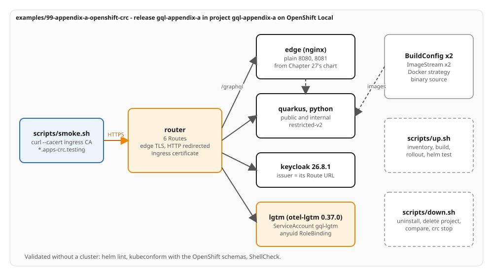

# Appendix A - OpenShift Local (CRC)

Chapter 27's chart on OpenShift Local. This appendix is a demonstration of the same code on another
distribution: the application, its images and Chapter 27's chart are unchanged, and everything OpenShift-specific
lives in this directory. It is a wrapper chart that depends on Chapter 27's chart through a `file://` dependency
and adds Routes, Docker-strategy builds, image streams and one SCC binding. The example has no `verify.sh`. The
proof is `up.sh` (which ends with `helm test`), then `smoke.sh`, then `down.sh`; the chart and the scripts are also
validated without a cluster.

## What it deploys

One release, `gql-appendix-a`, in the project `gql-appendix-a`:

| Object | Source | Notes |
|---|---|---|
| The final project | `charts/gql-ch27-final-1.0.0.tgz`, built from `examples/27-final-project/helm` | `edge`, `quarkus`, `python`, the two internal instances, `keycloak`, `lgtm`, NetworkPolicies, the helm test pod; values under `final:` |
| Route x6 | `templates/routes.yaml` | `quarkus` and `python` to the edge Service on its plain ports, `quarkus-internal`, `python-internal`, `grafana` and `keycloak` with edge TLS and HTTP redirected |
| BuildConfig x2, ImageStream x2 | `templates/buildconfigs.yaml`, `templates/imagestreams.yaml` | one per stack, derived from `final.stacks.*.image`; Docker strategy, binary source, `dockerfilePath: Containerfile` |
| ServiceAccount, RoleBinding | `templates/lgtm-anyuid-rolebinding.yaml` | the service account named by `final.lgtm.serviceAccountName`, bound to the `system:openshift:scc:anyuid` ClusterRole, for the observability image, which runs as root |

Every other workload runs under `restricted-v2` with the UID the project assigns: the chart sets no `runAsUser`,
`runAsGroup` or `fsGroup`. Routes terminate TLS at the router and forward to the edge's plain listeners (8080 for
Quarkus, 8081 for Python), so `final.edge.tls.enabled` is `false`. The Chapter 27 chart renders no `route.openshift.io`,
`build.openshift.io`, `image.openshift.io` or `security.openshift.io` object; this chart is the only place they exist.

## Layout

```
examples/99-appendix-a-openshift-crc/
  helm/Chart.yaml        gql-appendix-a 1.0.0; dependency gql-ch27-final 1.0.0, alias final, file://../../27-final-project/helm
  helm/Chart.lock        committed; `helm dependency build` restores charts/
  helm/values.yaml       final.* (the dependency's values) and openshift.* (routes, builds, anyuid)
  helm/templates/        routes, buildconfigs, imagestreams, lgtm-anyuid-rolebinding, NOTES.txt
  scripts/lib.sh         names, oc and helm wrappers that always name the context, require_crc, inventory helpers
  scripts/up.sh          inventory, project, build objects, in-cluster builds, the application, rollout, helm test
  scripts/smoke.sh       the final project's checks through the Routes
  scripts/down.sh        helm uninstall, delete the project, remove operators (none), compare with the inventory, crc stop
```

`helm/charts/` (the packaged dependency) is not committed: `.gitignore` lists it, and `helm dependency build`
recreates it from `Chart.lock`, which CI and `up.sh` both run.

## Run it

Prerequisites: OpenShift Local 2.64.0 (OpenShift 4.22.14, Kubernetes 1.35.6) set up with `crc setup`, `oc` on the PATH,
Helm v4.3.1 or newer, and every minikube profile stopped. The scripts check the profiles, name any that run and never
stop one. They talk to the cluster through the `crc-admin` kubeconfig context that `crc start` writes, so no password is
typed, read or printed.

```bash
minikube stop -p gql-tracking          # one cluster at a time
crc start
eval "$(crc oc-env)"
examples/99-appendix-a-openshift-crc/scripts/up.sh
examples/99-appendix-a-openshift-crc/scripts/smoke.sh
examples/99-appendix-a-openshift-crc/scripts/down.sh            # --keep-running leaves the cluster running
```

`up.sh` saves an inventory of the cluster first (non-system namespaces, Subscriptions, ClusterServiceVersions and
CRDs) under `~/.local/state/gql-appendix-a/`. It then installs the release with the build objects only, uploads
`examples/27-final-project/quarkus` and `python` with `oc start-build ... --from-dir ... --follow`, and installs the
application once both image stream tags exist. `down.sh` removes the release and the project, compares the cluster with
the inventory, prints anything that is not in it and leaves that alone, and then runs `crc stop`.

Reach the release by hand, with the cluster's ingress CA and never `--insecure`:

```bash
oc --context crc-admin -n openshift-config-managed get configmap default-ingress-cert \
  -o jsonpath='{.data.ca-bundle\.crt}' > ingress-ca.crt
curl --cacert ingress-ca.crt -H 'Content-Type: application/json' -d '{"query":"{ __typename }"}' \
  https://quarkus-gql-appendix-a.apps-crc.testing/graphql
```

## Routes

| Route | Host | Target | TLS |
|---|---|---|---|
| `quarkus` | `quarkus-gql-appendix-a.apps-crc.testing` | Service `edge`, port `quarkus` (8080) | edge, HTTP redirected |
| `python` | `python-gql-appendix-a.apps-crc.testing` | Service `edge`, port `python` (8081) | edge, HTTP redirected |
| `quarkus-internal` | `quarkus-internal-gql-appendix-a.apps-crc.testing` | Service `quarkus-internal`, 8080 | edge, HTTP redirected |
| `python-internal` | `python-internal-gql-appendix-a.apps-crc.testing` | Service `python-internal`, 8080 | edge, HTTP redirected |
| `keycloak` | `keycloak-gql-appendix-a.apps-crc.testing` | Service `keycloak`, 8080 | edge, HTTP redirected |
| `grafana` | `grafana-gql-appendix-a.apps-crc.testing` | Service `lgtm-ui`, port `grafana` | edge, HTTP redirected |

The two edge Routes carry a 1 h router timeout, which keeps a subscription or an event feed open between events.
Tokens are fetched at the Keycloak Route, so its URL is the issuer the stacks compare with: `up.sh` reads the cluster's
ingress domain and passes `final.identity.issuer=https://keycloak-gql-appendix-a.<domain>/realms/shipping`.
`values.yaml` carries the same value for `apps-crc.testing`.

## Static validation

No cluster is needed. From the repository root, with Helm v4.3.1, kubeconform v0.8.0 and ShellCheck v0.11.0:

```bash
helm dependency build examples/99-appendix-a-openshift-crc/helm
helm lint --strict examples/99-appendix-a-openshift-crc/helm
helm template gql-appendix-a examples/99-appendix-a-openshift-crc/helm -n gql-appendix-a \
  | kubeconform -strict -summary -kubernetes-version 1.35.6 \
      -schema-location default \
      -schema-location 'https://raw.githubusercontent.com/datreeio/CRDs-catalog/63669a570e231d4f1f8396d229a1de512bcf0a34/openshift/v4.15-strict/{{ .ResourceKind }}_{{ .Group }}_{{ .ResourceAPIVersion }}.json'
shellcheck -x examples/99-appendix-a-openshift-crc/scripts/*.sh
```

Recorded output of the commands above:

```text
1 chart(s) linted, 0 chart(s) failed
Summary: 40 resources found parsing stdin - Valid: 40, Invalid: 0, Errors: 0, Skipped: 0
```

The release renders 40 objects: 2 BuildConfigs, 6 ConfigMaps, 7 Deployments, 2 ImageStreams, 5 NetworkPolicies, the helm
test Pod, 1 RoleBinding, 6 Routes, 1 Secret, 8 Services and 1 ServiceAccount. The Route, BuildConfig and ImageStream schemas come from
the pinned datreeio CRDs-catalog commit (`openshift/v4.15-strict`); the rest validate against the Kubernetes 1.35.6
schemas, the version OpenShift 4.22.14 ships. The same render with `--set tags.app=false`, which `up.sh` uses for its first
install, holds the 2 BuildConfigs, 2 ImageStreams and 6 Routes. A grep of the render finds no `runAsUser`, `runAsGroup`
or `fsGroup`. `bash -n` and ShellCheck pass on every script.

## The recorded run

Run live on 2026-10-17 with crc 2.64.0, OpenShift 4.22.14 (Kubernetes v1.35.6) and `oc` 4.22.14, on a cluster that held
no operator and no project besides the system ones. The chapter's "On the wire" section holds the output.

| Step | Result | Time |
|---|---|---|
| `crc start` | ready | 5 min 38 s |
| `scripts/up.sh` | both builds complete, release deployed, `helm test` `Succeeded` | 2 min 1 s on a node that held the base images; Quarkus build 84 s, Python build 21 s |
| `scripts/smoke.sh` | `PASS`: restricted-v2 for six workloads and anyuid for `lgtm`; HTTP redirected on every Route; 413 for a 100 KB body; `maximum query complexity exceeded 7651 > 1000`; 8 source calls on Quarkus and 6 on Python; the trace found in Tempo | 15 s |
| `scripts/down.sh` | release and project removed; the cluster matches the inventory | 33 s |
| `crc stop` | stopped | 1 min 13 s |

The configuration choices:

- The wrapper sets `final.edge.image.pullPolicy`, `final.lgtm.image.pullPolicy` and `final.keycloak.image.pullPolicy` to
  `IfNotPresent`, because the cluster pulls those images from their registries; Chapter 27's defaults are for a node that
  holds them already.
- The `tag` of each stack's image is set in this chart's values as well as in the dependency's, because the build objects
  are created while the dependency is off (`tags.app=false`) and take their names from `final.stacks`.
- Keycloak reads the client's scheme and host from the router's `X-Forwarded-*` headers (`final.keycloak.proxyHeaders: xforwarded`), so a token fetched at its edge-TLS Route carries the Route's `https` URL.
- The observability pod names no seccomp profile (`final.lgtm.seccompProfile: ""`), which is what `anyuid` admits; every other pod keeps `RuntimeDefault`.
- The observability container keeps the constraint's default capability set (`final.lgtm.dropAllCapabilities: false`): the image creates its data directories in a root directory that only root with `CAP_DAC_OVERRIDE` can write. The value is Chapter 27's; its default, `true`, renders the chart as before.
- Both build stages run as root, so Maven and uv can create their output in the build directory; both runtime stages run as the image's non-root user. `up.sh` uploads each Chapter 27 directory as it is.
- A Docker-strategy build runs the Containerfile inside a build pod, so Maven and uv fetch their dependencies from inside
  the cluster. The BuildConfigs request 1 CPU and 2 GiB, with limits of 4 CPU and 4 GiB.

## Diagram



Editable source: `architecture.excalidraw`.
